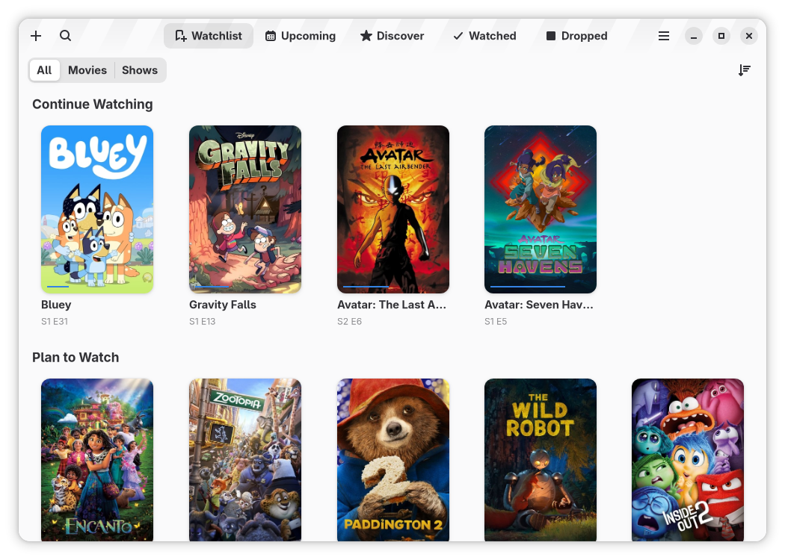
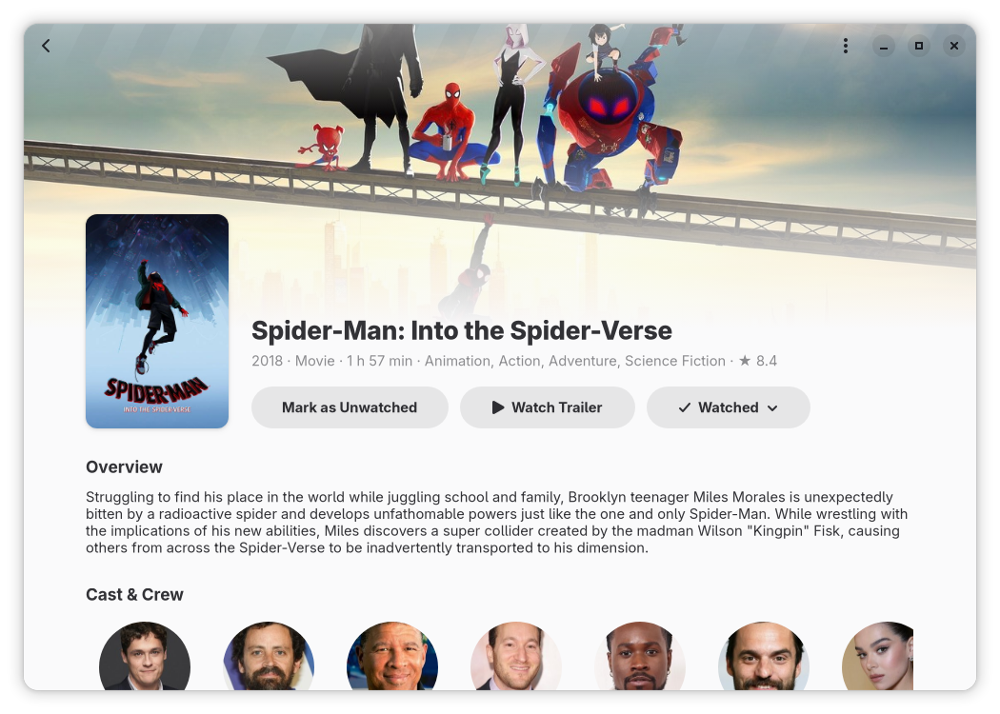
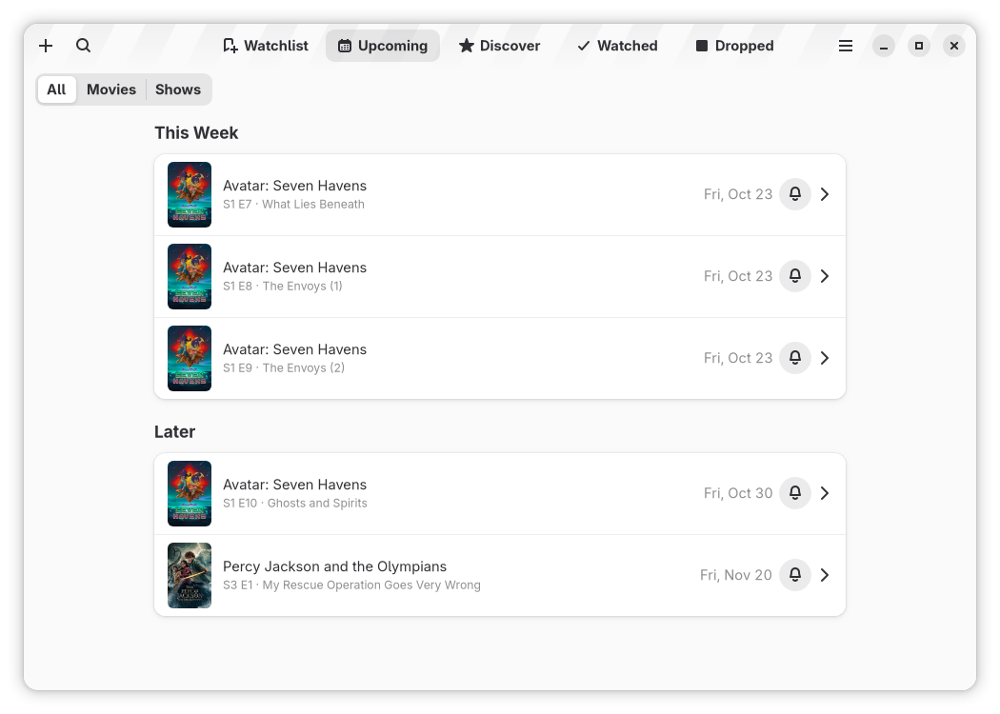
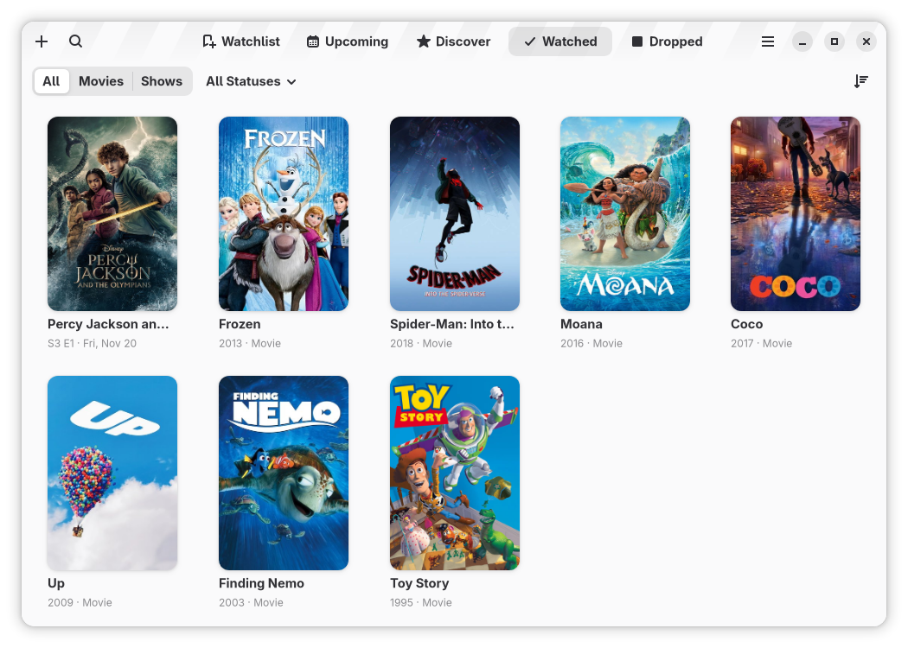

# Aperture

Keep track of your movies and TV shows.

Aperture lets you build a watchlist of movies and TV shows, keep track of what
you've watched, and find information about the latest releases. It is written
in Vala with GTK 4, libadwaita and Blueprint.

This app uses the TMDB API but is not endorsed or certified by TMDB.



| Details | Upcoming | Watched |
| --- | --- | --- |
|  |  |  |

- [Feature list](docs/FEATURES.md)
- [Screens & UI plan](docs/UI.md)
- [Library file format](docs/LIBRARY_FORMAT.md) (export/import)

## Building

Dependencies: `meson`, `valac`, `blueprint-compiler`, `gtk4 >= 4.18`,
`libadwaita-1 >= 1.8`, `libsoup-3.0`, `json-glib-1.0`, `sqlite3`, `libsecret-1`.

```sh
meson setup build -Dprofile=development -Dtmdb_api_key=YOUR_TMDB_READ_TOKEN
ninja -C build
GSETTINGS_SCHEMA_DIR=build/data ./build/src/aperture
meson test -C build   # validates desktop file, metainfo and schema
```

### Flatpak

```sh
flatpak-builder --user --install --force-clean .flatpak/build \
  build-aux/flatpak/io.github.jonnsl.Aperture.Devel.json
```

### Arch Linux

```sh
cd build-aux/arch
TMDB_API_KEY=YOUR_TMDB_READ_TOKEN makepkg -si   # the token is optional
```

### Code style

Vala sources are formatted with [Uncrustify](https://github.com/uncrustify/uncrustify)
and checked with [vala-lint](https://github.com/vala-lang/vala-lint); CI runs both.

```sh
build-aux/check-style.sh         # check
build-aux/check-style.sh --fix   # reformat in place
```

## License

GPL-3.0-or-later. See [COPYING](COPYING).
